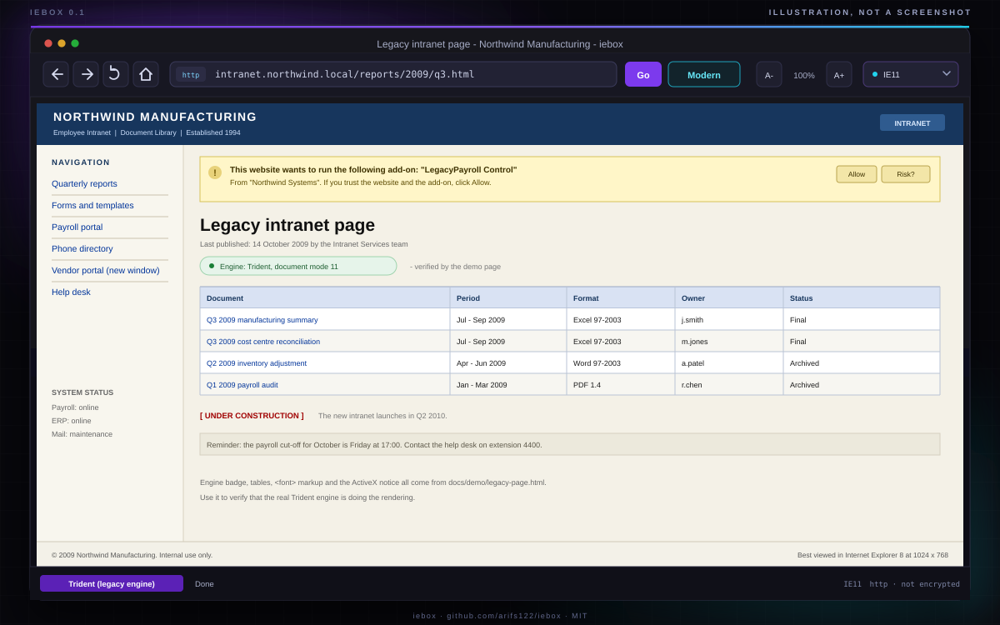

# iebox

**A free, open-source IE Tab alternative for Windows: open legacy IE-only sites in the real Trident engine.**

> **Not affiliated with IE Tab or Blackfish Software.** IE Tab is a commercial
> product of Blackfish Software; this is an independent project that solves a
> similar problem a different way (a standalone window, because browsers no
> longer allow the extension approach). "Internet Explorer", "Windows" and
> "Microsoft" are trademarks of Microsoft Corporation.

[](https://github.com/arifs122/iebox/actions/workflows/ci.yml)
[](LICENSE)
[](#requirements)
[](package.json)
[](package.json)

iebox is a small standalone Windows window that hosts **MSHTML/Trident**, the engine inside Internet Explorer 11. It is for the shrinking but stubborn set of pages that only work in IE: old intranet portals, vendor admin panels, ActiveX-dependent line-of-business tools, and pages that sniff for `document.all`.

It is not a browser engine. It is the real, retired engine in a modern-ish frame, compiled from source on your own machine.

> [!WARNING]
> **The Trident engine is unsandboxed and no longer receives security updates.**
> It has unfixed vulnerabilities. iebox gives a web page the same privileges as your Windows user, can load ActiveX controls, and has no site isolation, no tab sandbox and no modern TLS. Use it **only** for trusted legacy sites that you already have to use. Do not use it for banking, email, social media, shopping, or anything you would not run as a 2013 Internet Explorer window. See [SECURITY.md](SECURITY.md).

---

## What this is, and what it is not

**What it is**

- A free (MIT) open-source **standalone window** that renders pages with the actual MSHTML/Trident engine on Windows 10 and 11.
- A single-file C# WinForms host (`host/IeBoxHost.cs`) compiled at first run by the **built-in .NET Framework compiler** (`csc.exe`). No SDK, no NuGet, no MSBuild, no installer, no admin rights.
- A small Node.js CLI with a zero-dependency test suite covering URL handling, the emulation registry keys, the build cache, diagnostics and the CLI contract.
- Explicit about its risk. The first run shows a blocking warning, and the app never pretends to be a secure browser.

**What it is not**

- **Not a browser engine.** There is no new rendering code here. It is MSHTML, the retired IE11 engine.
- **Not Chromium, not Electron, not WebView2.** Those cannot render IE-only pages; that is the entire problem.
- **Not sandboxed or hardened.** The page runs in your user context.
- **Not private.** No tracking protection, no modern certificate stack, no isolation.
- **Not an enterprise browser or an Edge IE mode replacement.** Edge IE mode is managed, supported by Microsoft, and a better choice where it is available.
- **Not affiliated with Microsoft, IE Tab, or any prior-art project.**

## Why this cannot be a browser extension

A browser extension cannot embed Trident in a modern browser tab any more:

- **Chrome removed NPAPI in version 45 (2015).** NPAPI was the only way a Chrome extension could host a native rendering control. ActiveX was never supported.
- **Firefox removed NPAPI in version 52 (2017).** The same door closed.
- **WebExtensions are deliberately isolated.** They cannot create a Win32 window, load `mshtml.dll`, call COM, or hand a raw `HWND` to a browser tab.
- **IE Tab itself cannot do it with an extension alone.** The paid, closed-source product ships a native helper process and uses it to render outside the browser's sandbox. In other words, the extension is a remote control, not the engine.

The honest architecture on Windows is a **standalone window** that owns a WinForms `WebBrowser` control. That is what iebox builds. It is why the toolbar has a **Modern** button: when a page needs a real browser, hand it to the real browser.

## How it works

```text
iebox <url>
  |
  |-- src/build.js
  |     finds C:\Windows\Microsoft.NET\Framework64\v4.0.30319\csc.exe
  |     compiles host/IeBoxHost.cs -> %LOCALAPPDATA%\iebox\bin\iebox-host.exe
  |     caches by SHA-256 of the source (no recompile on every launch)
  |
  |-- src/registry.js
  |     writes HKCU\...\FeatureControl\FEATURE_BROWSER_EMULATION
  |       iebox-host.exe = 11001   (IE11 document mode)
  |
  `-- iebox-host.exe
        creates the WinForms window
        creates a WebBrowser control
        WebBrowser -> MSHTML/Trident -> the page
```

The registry value must exist **before** the `WebBrowser` control is created. Without it the control defaults to IE7 mode and most intranet pages break. The host writes it itself at startup, and the CLI writes it before spawning the host as a belt-and-braces measure. The emulation drop-down changes it and reloads; some pages only pick up the new mode after a host restart, which the dialog says plainly.

The compiled host is intentionally boring: one C# file, no external assets, no updater, no telemetry. The only network traffic is the page you asked it to open.

## Requirements

- **Windows 10 or Windows 11.** The MSHTML engine and the WinForms `WebBrowser` control do not exist anywhere else. On macOS/Linux every command exits 2 with `iebox is Windows-only`.
- **Node.js 18 or newer.** Tested with Node 24. No npm packages are installed at runtime or in development.
- **.NET Framework 4.x**, which ships with Windows 10/11. iebox uses its `csc.exe`; it does not need Visual Studio, the Windows SDK, MSBuild or NuGet.
- `mshtml.dll` present in `C:\Windows\System32`. `iexplore.exe` is **not** required (the COM engine can exist without the browser executable; `iebox doctor` reports it as informational).

## Quick start

```powershell
git clone https://github.com/arifs122/iebox.git
cd iebox

# 1. See what the machine has (no writes, no network)
node bin/iebox.js doctor

# 2. Open the bundled legacy demo page
node bin/iebox.js docs/demo/legacy-page.html
```

The first launch compiles the host (roughly 250 ms on a normal machine), writes the HKCU emulation value, and opens the window. The first run also shows the security warning; tick "Don't show this warning again" only if you understand the trade-off.

Optional, to get an `iebox` command on your PATH:

```powershell
npm link
iebox https://intranet.example.local/
```

There is **no `npm install` step**, because there are no dependencies. `npm test` runs the suite with `node --test`.

## Camera systems, NVRs and ActiveX

This is what many people actually need iebox for: an NVR or IP camera whose web
UI only works in Internet Explorer, usually because the live view is an ActiveX
control.

1. **The host is 32-bit by default**, because nearly every vendor ActiveX control
   (Hikvision, Dahua, Uniview, …) ships as x86 only and a 64-bit process cannot
   load it. `iebox doctor` shows which architecture you have. If your control is
   64-bit, rebuild with `iebox build --force --arch x64`.
2. Open the panel: `iebox http://192.168.1.64/`
3. If the page says the plugin is missing, try the emulation mode the vendor
   documents. Most are IE11; older firmware wants IE8/IE9:

   ```powershell
   iebox --emulation ie8 http://192.168.1.64/
   ```

4. **Allow the control.** Windows blocks unsigned ActiveX by default:
   - Internet Options → Security → **Trusted sites** → add the camera's IP
     (`http://192.168.1.64`), untick "Require server verification".
   - For that zone: Custom level → **Initialize and script ActiveX controls not
     marked as safe** → *Prompt* (or *Enable* on a machine that only ever touches
     the camera LAN).
5. If the firmware is old enough to speak only TLS 1.0/1.1, enable those in
   Internet Options → Advanced — or better, put the camera on an isolated VLAN.

**What will not work:** plugins that were **NPAPI** (the old Firefox/Chrome
kind) instead of ActiveX. Those cannot load in Trident either; use the vendor's
native client for that model.

The ActiveX control runs native code with your Windows user's privileges. That
is the whole point of using this engine, and it is the risk. Keep the camera UI
on a trusted network.

## Features

| Feature | Behaviour |
| --- | --- |
| Real engine | WinForms `WebBrowser` -> MSHTML/Trident (IE11 document mode by default). No emulation layer, no user-agent spoofing. |
| Navigation | Back, Forward, Stop/Reload, Home, editable address bar and **Go**. |
| Address helpers | `example.com` becomes `http://example.com/`; `localhost:3000`, `C:\pages\index.html`, `about:blank`, `data:` and `file:` URLs work; unicode and spaces are encoded; trailing dots on host names are stripped. |
| Modern button | Opens the current URL in the default browser via `Process.Start(UseShellExecute=true)`. |
| Document modes | IE11 (11001), IE10 (10001), IE9 (9999), IE8 (8888), IE7 (7000). The drop-down writes HKCU for `iebox-host.exe` and reloads. |
| First-run warning | Modal warning with a persisted "Don't show this warning again" checkbox. |
| Error overlay | Friendly panel when Trident cannot render a page (often TLS 1.3 or a missing cipher), with Retry, Open in modern browser and Copy URL. |
| Status bar | A visible **Trident (legacy engine)** badge, progress, page status and an HTTP/HTTPS hint. |
| Popups | `target=_blank` and `window.open` are intercepted (`NewWindow3`/`NewWindow2`); the URL opens in the same window rather than in a new IE window. |
| Window state | Size, position, zoom, last URL, home URL and emulation are stored in `%LOCALAPPDATA%\iebox\config.json`. |
| Keyboard | `Ctrl+L` address, `Alt+Left/Right` history, `F5`/`Ctrl+R` reload, `Ctrl+0/+/-` zoom, `Ctrl+P` print, `Esc` stop. |
| Build cache | SHA-256 of `host/IeBoxHost.cs` plus exe size; `iebox build --force` recompiles on demand. |
| Diagnostics | `iebox doctor` checks Windows, `mshtml.dll` and its version, CLR, `csc.exe`, the compiled host, the HKCU value and the config. `--json` for machines. |
| No dependencies | Zero npm packages, runtime or development. Tests use `node:test` and `node:assert/strict`. |
| No surprises | No telemetry, no analytics, no auto-update, no network calls except the page you navigate to. No certificate bypass. Writes only `%LOCALAPPDATA%\iebox` and one HKCU value. |

## CLI

```text
iebox [url]                    open a URL (or the saved home page) in the legacy engine
iebox build [--force]          compile the host (automatic on first run)
iebox doctor [--json]          diagnose the environment
iebox emulation <mode>         set the default emulation (ie11|ie10|ie9|ie8|ie7)
iebox config                   print the resolved config paths and values
iebox uninstall                remove %LOCALAPPDATA%\iebox and the HKCU value
      --home                   open the saved home page
      --emulation <mode>       override for this run only
      --no-color / -q          terminal polish (`-q` also hides progress lines)
  -h, --help / -v, --version
```

| Command / option | What it does |
| --- | --- |
| `iebox <url>` | Builds the host if needed, writes the emulation value, launches the window detached and returns. If the host exits immediately, prints a diagnostic about headless/non-interactive sessions instead of hanging. |
| `--home` | Ignores the argument and opens `homeUrl` from the config. Cannot be combined with a URL. |
| `--emulation <mode>` | Applies to this run only; does not change the saved default. |
| `iebox build` | Compiles `host/IeBoxHost.cs` to `%LOCALAPPDATA%\iebox\bin\iebox-host.exe`. Reuses a valid cache. |
| `iebox build --force` | Recompiles even when the cache matches. |
| `iebox doctor` | Human-readable report with a verdict line. Exit 2 if the engine or compiler is missing. |
| `iebox doctor --json` | The same report as JSON, including every check and the paths. |
| `iebox emulation ie9` | Saves the default mode in `config.json` and writes HKCU for `iebox-host.exe`. |
| `iebox config` | Prints directory, config file, host exe, build metadata, the config values and the current HKCU value. `--json` is supported. |
| `iebox uninstall` | Deletes exactly the `iebox-host.exe` HKCU value and `%LOCALAPPDATA%\iebox`. Leaves other apps' emulation values and the parent registry key alone. Idempotent. |
| `-q`, `--no-color` | Plain output. Errors are still printed. |

Exit codes: **0** success, **1** user error (bad URL, unknown mode, unexpected argument), **2** operational error (unsupported platform, compiler missing, engine missing, launch failure).

## Screenshots



**This is an illustration, not a screenshot.** It is a hand-authored SVG mock (`docs/screenshot-mock.svg`) of the real layout, because this project is developed and tested in an environment where the GUI cannot be captured. The actual window uses native WinForms chrome and is less polished than the drawing; the toolbar, address bar, Modern button, emulation drop-down, legacy page and status badge are all real.

## Prior art

iebox stands on ideas other people had first. Credit where it is due:

| Project | What it is | Why iebox is different |
| --- | --- | --- |
| [Xangis/ThreeTeeth](https://github.com/Xangis/ThreeTeeth) (~7 stars) | A minimal Trident-based browser. | Abandoned and bare: no address normalization, no build cache, no diagnostics, no error handling, no tests. iebox is maintained, packaged and explicitly documents its risk. |
| [sdesalas/trifleJS](https://github.com/sdesalas/trifleJS) (~832 stars) | Headless IE automation and testing. | trifleJS is for scripts and CI, not a browsable window. iebox is an interactive browser window for humans. |
| [donaddon/ietabpro](https://github.com/donaddon/ietabpro) (~2 stars) | An old, incomplete IE Tab clone. | Unmaintained and extension-shaped, from the era when embedding was still possible. iebox is a standalone WinForms host with a CLI and tests. |
| [lechuguilla/ie-tab-seamless](https://github.com/lechuguilla/ie-tab-seamless) (~1 star) | Another old, incomplete IE Tab clone. | Same: a historical experiment, not a working, documented tool. |
| [IE Tab](https://www.ietab.net/) | The paid, closed-source extension that most people mean when they say "IE Tab". | IE Tab is proprietary, requires a native helper, and cannot be audited. iebox is MIT, builds from source on your machine, and is honest that the result is a separate window. |

Prior art is listed for fairness, not as an accusation. If one of these projects already does what you need, use it.

## Security model

**Threat model: the page is trusted, the network is not necessarily.** iebox is for a specific intranet page that you already have to use. It is not a general-purpose browser.

- **No sandbox.** MSHTML runs in the host process with your user token. A malicious page can do anything your user account can do, within the limits of the engine. There is no process isolation between pages, because there is only one page.
- **No security updates.** Microsoft retired the IE11 desktop application on 15 June 2022. `mshtml.dll` still exists for compatibility and Edge IE mode, but it is not a supported browsing surface. Assume unfixed vulnerabilities.
- **ActiveX is possible.** That is often the point, and it is also the risk. A control can run native code.
- **No certificate bypass.** iebox does **not** override `ServicePointManager.ServerCertificateValidationCallback` or install any certificate handler. TLS is whatever the OS/Trident stack supports; many modern HTTPS sites fail, and the overlay suggests the Modern button instead of weakening TLS.
- **Old TLS only.** Trident does not speak TLS 1.3. Some sites negotiate TLS 1.2 with legacy ciphers; some do not negotiate at all.
- **HKCU only.** The emulation value is written under `HKEY_CURRENT_USER`. iebox never writes HKLM, never requests elevation, and never installs a service or driver.
- **Writes are bounded.** `%LOCALAPPDATA%\iebox\config.json`, `%LOCALAPPDATA%\iebox\bin\iebox-host.exe`, `%LOCALAPPDATA%\iebox\bin\build.json`, and one HKCU DWORD value. Nothing else. Uninstall removes exactly those.
- **No telemetry or network calls.** The Node CLI never phones home. `doctor` uses local PowerShell only to read file versions. The host only navigates to the URL you give it.
- **Popups stay in the window.** A `target=_blank` link does not get a fresh unsandboxed IE window; it is cancelled and opened in the same host.
- **No auto-update.** Updates are your responsibility; the source is right here.

If you need isolation, use a disposable Windows VM with no access to your real credentials. If you need a supported engine, use Edge IE mode. If neither works, the legacy page probably needs to be replaced.

## iebox compared

|  | **iebox** | **IE Tab** | **Edge IE mode** |
| --- | --- | --- | --- |
| Price | Free, MIT | Paid, proprietary | Included with Windows/Edge |
| Source code | Open, auditable | Closed | Closed |
| Rendering engine | MSHTML/Trident | MSHTML via a native helper | MSHTML in an Edge-managed process |
| Where it renders | Standalone window | Browser tab (extension + helper) | Edge tab |
| Sandbox | No | No | More isolated than a raw MSHTML window, still legacy |
| ActiveX | Yes | Yes | Yes |
| Platform | Windows 10/11 | Windows | Windows 10/11 |
| Installation | Clone and run; compiles with built-in `csc.exe` | Extension store + helper | Enterprise policy / Windows configuration |
| Document modes | IE11/10/9/8/7 | Several | Managed IE mode modes |
| Diagnostics | `iebox doctor` | Vendor UI | Edge/enterprise tooling |
| Support | Community, best effort | Commercial | Microsoft |
| Honest about risk | Yes, in the window and the docs | Varies | Yes, in enterprise docs |

Edge IE mode is the right answer for managed organizations that need a supported legacy surface. iebox is for people who want a small, free, auditable window and understand the trade-off.

## Project structure

```text
iebox/
  bin/iebox.js              thin executable wrapper
  src/
    cli.js                  arguments, orchestration, exit codes, help
    build.js                csc discovery, compile, SHA-256 cache
    launch.js               detached spawn, headless detection
    config.js               %LOCALAPPDATA%\iebox\config.json
    registry.js             HKCU FEATURE_BROWSER_EMULATION value + reg.exe args
    emulation.js            mode -> registry value map
    doctor.js               environment diagnostics (injectable probe)
    url.js                  URL normalisation
    util.js                 errors, exit codes, ANSI, platform guards
  host/
    IeBoxHost.cs            the WinForms/MSHTML host (single file, C# 5)
  test/                     node:test suite (URL, config, registry, build, doctor, CLI, compile smoke)
  docs/
    screenshot-mock.svg     the illustration used above
    demo/
      legacy-page.html      deliberately old-school demo page
      README.md             how to try it
      cli.txt               real output from this machine
  .github/workflows/ci.yml  Linux/macOS tests + Windows build/doctor job
  package.json              zero dependencies, ESM, Node >= 18, os: win32
```

The config file is flat JSON so the C# host can read it with a tiny parser:

```json
{
  "homeUrl": "file:///C:/iebox/docs/demo/legacy-page.html",
  "lastUrl": "http://intranet.example.local/",
  "emulation": "ie11",
  "seenWarning": true,
  "zoom": 100,
  "windowX": 120,
  "windowY": 80,
  "windowWidth": 1200,
  "windowHeight": 800,
  "windowMaximized": false
}
```

## Contributing

Bug reports, small fixes and careful feature work are welcome. Read [CONTRIBUTING.md](CONTRIBUTING.md) and [CODE_OF_CONDUCT.md](CODE_OF_CONDUCT.md) first.

- Run `npm test` before opening a pull request. The suite has no dependencies and does not touch the real registry.
- If you change `host/IeBoxHost.cs`, compile it with the built-in compiler and run the Windows-only smoke test: `node --test test/compile-smoke.test.js`.
- Keep `host/IeBoxHost.cs` ASCII-only and C# 5-compatible (`csc.exe` 4.0.30319). Use `\uXXXX` escapes for typographic characters.
- Never add certificate bypasses, telemetry, elevation, HKLM writes, or npm dependencies.

Security issues: please use the process in [SECURITY.md](SECURITY.md), not a public issue.

## License

MIT. Copyright (c) 2026 arifs122. See [LICENSE](LICENSE).

Not affiliated with Microsoft Corporation, IE Tab, or the prior-art projects listed above. "Internet Explorer", "Trident" and "Windows" are trademarks of Microsoft. Use at your own risk.
